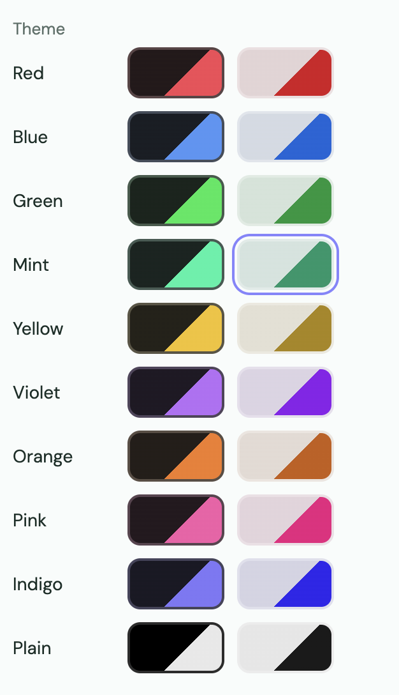
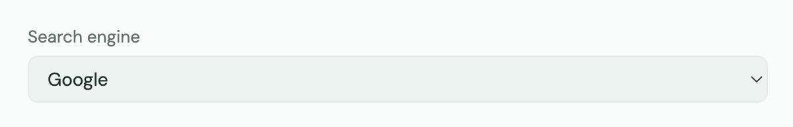
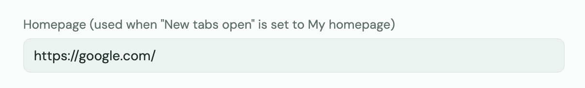
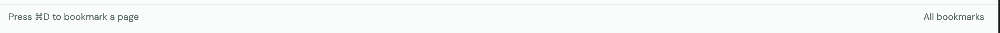
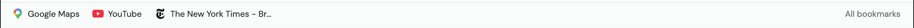

# Macha
Meet the all-in-one personal, customizable browser you can edit for your needs
## How to setup
**Start using your new Macha browser the best way by this guide**
### 1. Set up your browser theme
**We like Macha mint, but you can choose a total of 11 themes, colors of both dark and light mode, or plain white or black**

### 2. Setup your search engine
**You can choose from Google, Bing, Brave, Ecosia, or DuckDuckGo**

### 3. Homepage
**Want to read some news to kick off your browsing session? Set it as your homepage and view it right off the go.**

### 4. Set up bookmarks
**Have webpages you visit often? Set them as bookmarks!**

> Soon, you'll be able to import bookmarks from other browsers (Firefox, Chrome, Edge, Safari, etc.)

# To-do:
* Setup wizard
* Downloads handler
* Ad/tracker blocking
* Machaccount setup
* Extensions (?)
* Android app (?)